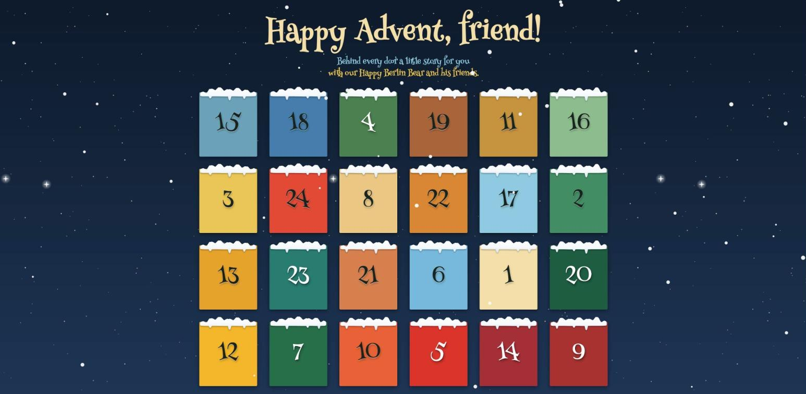

# Advent calendar

An online Advent calendar with 24 doors that open one by one through December. Each door holds a surprise: a picture, a short text, a YouTube video, or an audio recording. It is plain HTML, CSS, and JavaScript, with no build step and no server code, so it runs from any web host or straight from your computer.

The calendar was created in 2025 by [@HenniePenny](https://github.com/HenniePenny) and [@tlcoles](https://github.com/tlcoles). This repository is a fork of the original, [HenniePenny/adventCalendar2025](https://github.com/HenniePenny/adventCalendar2025), and holds the 2026 edition by Tammi L. Coles: 24 Happy Berlin Bear stories, each with an illustration and a recording. You can see it live at [tlcoles.com](https://tlcoles.com/).



## Features

- **24 doors in a shuffled order.** Each visitor gets their own random order, which stays the same on their device.
- **Doors open by date.** Each door unlocks at midnight on its December day, in the visitor's local time, even if the page has been open all night. Earlier doors stay open. A locked door answers with a playful message.
- **Four kinds of surprise.** Pictures, short texts, YouTube videos, and audio recordings with an optional picture, shown in a popup.
- **Saved progress.** The calendar remembers which doors a visitor has opened. A Reset button, with a confirmation step, closes them all and shuffles the order again.
- **Optional Santa laugh.** Visitors can switch on a "Ho Ho Ho" that plays when a door is opened for the first time.
- **Falling snow,** which switches itself off when the visitor's device asks for reduced motion.
- **Works on phones, tablets, and desktops.** Phones get a compact 4 × 6 grid, and on a 1920 × 1080 monitor all 24 doors fit without scrolling.
- **English and German.** Visitors whose browser is set to German get the door labels, buttons, and locked-door messages in German.
- **Accessible.** Doors are real buttons that work with the keyboard and screen readers (see [Accessibility](#accessibility)).
- **Optional extras:** a section introducing the characters, a link preview image for messaging apps, and a favicon.

## Quick start

1. Download this repository with the green **Code** button (**Download ZIP**), or clone it:

   ```bash
   git clone -b advent-calendar-2026 https://github.com/tlcoles/adventCalendar.git
   ```

2. Open `index.html` in your browser. Nothing needs to be installed.

Before December, all doors are locked. To look behind them while you work, turn on testing mode (see [Testing](#testing)).

## Make it your own

### Surprises

The content of the doors lives in the `surprises` array in `script.js`. It has 24 entries, one per day, in order from day 1 to day 24. Replace an entry to change that day's surprise. You can mix all four types freely.

| Type | Fields | Shows |
| --- | --- | --- |
| `image` | `src`, `alt` | A picture |
| `text` | `title`, `body` | A short message or quote |
| `youtube` | `url`, `title` | An embedded YouTube video |
| `audio` | `src` (required), `title`, `description`, `image`, `alt` | An audio player, with an optional picture above it |

Examples:

```js
{
  type: "image",
  src: "assets/surprises/my-photo.webp",
  alt: "A mug of cocoa and cookies by the fire"
},
{
  type: "text",
  title: "A thought for today",
  body: "Every door you open is a small reason to smile."
},
{
  type: "youtube",
  url: "https://youtu.be/dQw4w9WgXcQ",
  title: "A festive favorite"
},
{
  type: "audio",
  title: "The tram surprise",
  image: "assets/2026/images/day-18-the-tram-surprise.webp",
  alt: "The bear in a Santa hat lifting a wrapped green present into the open door of a yellow tram",
  src: "assets/2026/audio/day-18-the-tram-surprise.mp3"
}
```

Always give `alt` text for a picture, so visitors who use screen readers know what it shows.

**Audio doors** use the browser's own player, so they work on phones too. A recording never plays by itself: visitors press Play, and can pause and skip through it. Playback stops when the popup closes or another door is opened. The picture is shown above the player and on the opened door, with a small ▶ badge in its corner that invites visitors to listen again, and is kept short enough that the player stays visible on small laptop screens. Use MP3 files for the widest browser support.

**The Santa laugh** plays once when a door is opened for the first time, if the visitor has switched it on. On audio doors, pressing Play stops the laugh, so the two never overlap. It does not play for YouTube doors.

**No coding needed:** to swap in your own pictures or recordings without editing `script.js`, replace the existing files with your own under the same file names.

### Your files

Put your files in `assets/`. This edition keeps them in `assets/2026/audio/` and `assets/2026/images/`, named `day-NN-short-title`; the 2025 pictures are in `assets/surprises/`. Settings that work well:

- **Recordings:** MP3, 64 kbps mono, which comes to about 0.5 MB per minute. Level all recordings to the same loudness (this edition uses about −21 LUFS, with peaks below −1 dBFS), so visitors do not have to change the volume from one door to the next.
- **Pictures:** WebP, 900 × 900 px, about 110 KB each.

### Heading and look

The heading and the two lines below it are in `index.html`.

The look of this edition comes from `theme-2026.css`, which `index.html` loads after the shared `styles.css`. The colors are set as variables at the top of the theme file, and each door's colors are set with the `--door-bg`, `--door-ink`, and `--door-opened-bg` settings that `styles.css` provides. Closed doors carry a drawn snow drift, which disappears when a door is opened so the picture shows in full. The theme also sets the door shape: just taller than wide on phones, so the calendar stays short; tall and narrow on tablets; and only slightly taller than wide from 1024 px, so the whole calendar fits on a 1920 × 1080 screen.

To design your own look, edit `theme-2026.css` or replace it with your own file. To use the original 2025 look, remove the `theme-2026.css` line from `index.html`:


### Character section (optional)

"Our Happy Berlin Bear & his friends" sits below the calendar in `index.html`. It is a `<details>` element, so it opens and closes without extra code and works with the keyboard and screen readers. It starts closed, and the calendar remembers whether a visitor left it open. Edit the picture, captions, and alt text in `index.html`; the styles are in the block of the same name at the end of `styles.css`. To leave it out, delete the `<details id="castSection">` block.

### Link preview (optional)

The Open Graph and Twitter card tags in the `<head>` of `index.html` set the title, description, and picture that appear when someone shares the calendar link in WhatsApp, Signal, or social media. Change them to your own text and address. The picture address must be a full URL, including your domain. Use a JPEG of 1200 × 800 px under 300 KB, so WhatsApp shows it. Messaging apps remember previews, so a change can take a while to show for links shared before.

### Footer and favicon

The footer credits and the legal notice ("Impressum") link are at the end of `index.html`; change them to your own. The favicon in `assets/favicon/` is a calendar door with "24": `favicon.svg` for most browsers, `favicon.ico` (16, 32 and 48 px) as a fallback, and `apple-touch-icon.png` (180 px) for phone home screens.

## Testing

Doors stay locked until their December date, so you need a way to open them while you build.

- **Unlock all doors:** set `const FORCE_TESTING_MODE = true;` near the top of `script.js`. Set it back to `false` before you publish, because it unlocks the doors for every visitor.
- **Pretend it is a certain December day:** in `script.js`, uncomment the two lines below "Uncomment the two lines below for testing purposes" and set the day you want. Comment them out again before you publish.
- **Test on the live website,** for example on a real phone, with a temporary copy:
  1. Copy `index.html` to `preview.html` and `script.js` to `preview-script.js`.
  2. In `preview.html`, change `script.js` to `preview-script.js`, and add this line inside `<head>` so search engines skip the page:
     `<meta name="robots" content="noindex, nofollow">`
  3. In `preview-script.js`, set `FORCE_TESTING_MODE = true`.
  4. Upload both files and open `yoursite.com/preview.html` **in a private or incognito window**. The calendar remembers opened doors in the browser, and a private window keeps that memory separate, so doors you open while testing will not show as opened on your real calendar.
  5. Delete both files when you are done.

Check Safari on an iPhone, Chrome on Android, and a desktop browser: opening doors, closing and switching popups, playing and pausing audio, the Santa laugh, the Reset button, and the character section. Also go through the page with the keyboard alone (Tab, Enter, and Esc).

## Publishing

The calendar is a static site. Upload `index.html`, `styles.css`, `theme-2026.css`, `script.js`, `snowEffect.js`, and the `assets/` folder to your web host, for example GitHub Pages, Netlify, or your own server.

1. Make sure `FORCE_TESTING_MODE` is `false` and the test date lines are commented out.
2. Whenever you change `styles.css`, `theme-2026.css`, or `script.js`, raise the matching `?v=` tag in `index.html` (for example from `?v=2026c` to `?v=2026d`). Returning visitors then get the new file and not an old copy from their browser.
3. After uploading, reload the page with Cmd+Shift+R or Ctrl+Shift+R to see your changes.

## What the calendar stores

The calendar keeps its state in the visitor's browser (`localStorage`), on that device only. If the browser blocks storage, the calendar still works, but forgets opened doors when the page is closed.

| Key | Purpose |
| --- | --- |
| `openedDoors-YYYY-12` | Doors opened this December (a new key each year, so every year starts with closed doors) |
| `doorOrder` | The visitor's shuffled door order |
| `soundEnabled` | Whether the Santa laugh is switched on |
| `castOpen` | Whether the character section was left open |

The Reset button clears the opened doors and the door order.

## Accessibility

- **Keyboard and screen readers.** Each door is a button, so it works with Tab, Enter, and Space. Screen readers announce each door's number and state, for example "Door 5, locked. Opens on December 5."
- **Popups.** The story window and the reset dialog keep keyboard focus inside, close with Esc, and return focus to where the visitor was. The page behind them cannot be reached until they close.
- **Locked doors.** The message is also announced to screen readers and stays on screen for 6 seconds.
- **Reset.** The confirmation dialog starts on Cancel, so a stray Enter cannot clear anyone's progress.
- **Focus outlines** on doors and buttons show where the keyboard is.
- **Reduced motion.** The snow and the door effects stop when the device is set to reduce motion.
- **Text alternatives.** Pictures carry alt text, and the audio player has a label.
- **Browsers.** Works in current versions of Chrome, Safari, Firefox, and Edge, with mouse, touch, or keyboard.

## Credits

**Created by** [@HenniePenny](https://github.com/HenniePenny) and [@tlcoles](https://github.com/tlcoles) in 2025.

**2026 edition:** the Happy Berlin Bear stories, illustrations, and recordings, and the changes in this fork, are by Tammi L. Coles ([@tlcoles](https://github.com/tlcoles)).

**Acknowledgements**

- **Public domain Christmas cartoons** in the 2025 calendar, shown via YouTube, including _Christmas Comes But Once a Year_ (1936, Fleischer Studios), _Jack Frost_ (1934, Ub Iwerks), _Snow Foolin'_ (1949, Famous Studios), and _The Pups' Christmas_ (1936, Happy Harmonies).
- **Festive pictures** in the 2025 calendar, adapted from royalty-free sources such as [Pixabay](https://pixabay.com/), [Unsplash](https://unsplash.com/), and [Pexels](https://www.pexels.com/).
- **The font** _Henny Penny_, from [Google Fonts](https://fonts.google.com/).
- **AI assistance.** Special thanks to all the coders whose work seeds the large language models behind ChatGPT (OpenAI) and Claude (Anthropic). The original creators used ChatGPT for technical guidance, code, and creative collaboration in 2025. For the 2026 edition, Tammi used both for technical guidance and hands-on help with preparing the recordings and illustrations for the web, the character section and link preview, the Santa laugh on audio doors, the favicon, the 2026 theme, testing on phone and desktop sizes, and this documentation.

## Contributing

Fixes and features that would help any calendar are best offered as a pull request to the original repository, [HenniePenny/adventCalendar2025](https://github.com/HenniePenny/adventCalendar2025). Changes specific to the 2026 edition belong in this fork.

## License

Free to use, share, and remix — just spread the joy and credit the original project.
